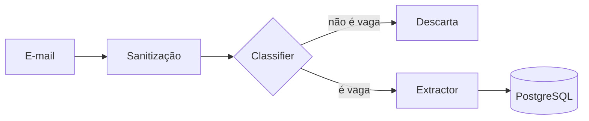

# ResuMe

O nome é um trocadilho entre _resume_ (currículo) e _me_ (eu). A ideia é ter um assistente pessoal para cuidar das minhas candidaturas.

Comecei esse projeto porque, quando você se candidata a muitas vagas ao mesmo tempo, perde o controle rápido: em qual etapa cada processo está, quem já respondeu, quem recusou. E ainda tem o trabalho de adaptar o currículo para cada vaga. O ResuMe tenta resolver isso usando agentes de IA.

Também é meu projeto de portfólio na trilha de AI Engineer, então está sendo construído aos poucos e o código é aberto.

## O que já funciona

Você cola o texto de um e-mail de processo seletivo e o ResuMe faz quatro coisas:

1. Troca dados pessoais (e-mail, telefone, CPF e links) por marcadores antes de mandar o texto para o modelo.
2. Decide se o e-mail é mesmo de um processo seletivo. Spam e newsletters são descartados.
3. Extrai empresa, cargo, status, requisitos e próximos passos, em um formato validado com Pydantic.
4. Salva a candidatura no PostgreSQL. Se já existir uma da mesma empresa e cargo, atualiza o status em vez de criar outra.



O fluxo é um grafo do LangGraph, e cada etapa é um nó separado. Isso facilita testar e trocar cada parte.

## Tecnologias

- Python, FastAPI e Pydantic
- LangGraph para orquestrar os agentes
- SQLAlchemy e PostgreSQL
- Gemini como modelo padrão, ou Ollama para rodar localmente
- Pytest
- Docker Compose para o banco

O front-end (Next.js com Tailwind) ainda vai entrar.

## Como rodar

Você vai precisar de Python 3.11 ou mais novo, Docker e uma chave de API do Gemini. Existe uma camada gratuita, mas os limites mudam, então vale conferir no [Google AI Studio](https://aistudio.google.com/apikey).

```powershell
git clone https://github.com/RianLMA-dev/ResuMe.git
cd ResuMe

Copy-Item .env.example .env
# abra o .env e cole sua GOOGLE_API_KEY

docker compose up -d

cd backend
python -m venv .venv
.venv\Scripts\Activate.ps1
pip install -r requirements.txt

uvicorn app.main:app --reload
```

Depois é só abrir http://127.0.0.1:8000/docs e testar pelo Swagger. No Linux ou macOS, use `cp` no lugar de `Copy-Item` e `source .venv/bin/activate` para ativar o ambiente.

Rotas disponíveis: `POST /emails` analisa e salva um e-mail, `GET /applications` lista as candidaturas e `GET /health` confere se a API está no ar.

## Testes

```powershell
cd backend
pytest -v
```

Os testes usam um modelo simulado e um SQLite em memória, então rodam sem chave de API e sem gastar nada.

## Qual modelo usar

Cada pessoa usa a própria chave. Quem quiser pode escolher o provedor no `.env`:

- `LLM_PROVIDER=gemini` usa o Gemini e precisa de `GOOGLE_API_KEY`.
- `LLM_PROVIDER=ollama` roda o modelo no seu computador, sem custo e sem mandar nada para fora. Precisa instalar o `langchain-ollama`.

## Sobre privacidade

E-mails de recrutadores e currículos têm dados pessoais, então tentei me preocupar com isso desde o começo. A sanitização acontece antes de qualquer chamada ao modelo.

Ela é feita com expressões regulares, então **não pega nomes de pessoas**. Se isso for um problema para você, use o Ollama.

## O que falta fazer

- [x] Schemas e saída estruturada
- [x] Sanitização de dados pessoais
- [x] Classifier e Extractor no LangGraph
- [x] API com testes automatizados
- [x] Persistência no PostgreSQL
- [ ] Kanban em Next.js
- [ ] Resume Optimizer, que compara o currículo com a vaga e sugere palavras-chave e ajustes
- [ ] Um jeito melhor de ligar e-mails diferentes ao mesmo processo (hoje a comparação é por texto)
- [ ] Migrações com Alembic
- [ ] Dataset de avaliação para comparar modelos em acurácia e custo
- [ ] CI com GitHub Actions e deploy

## Licença

MIT.
