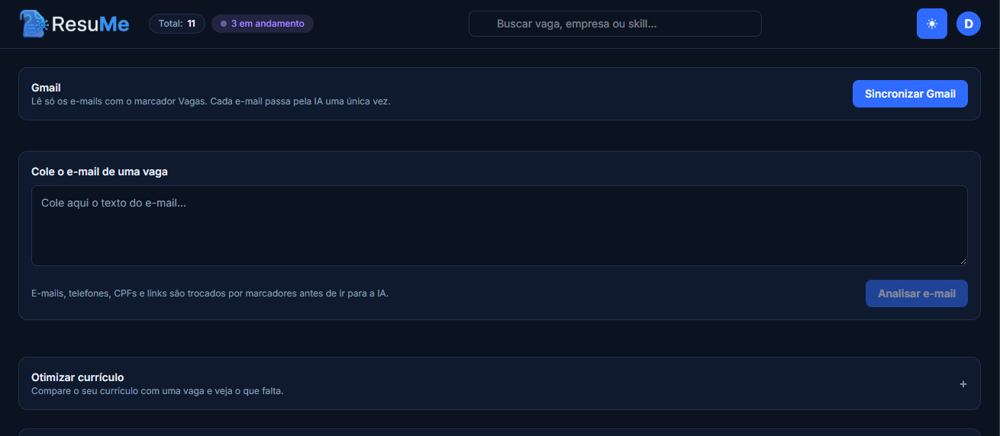
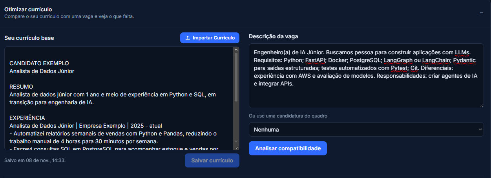
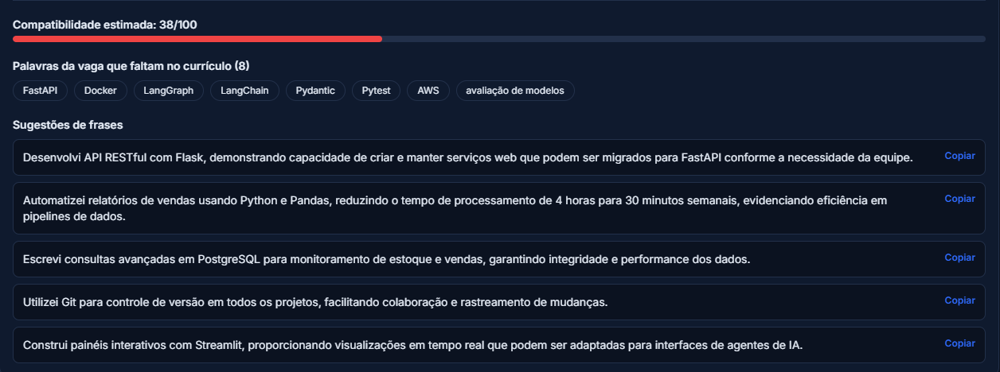
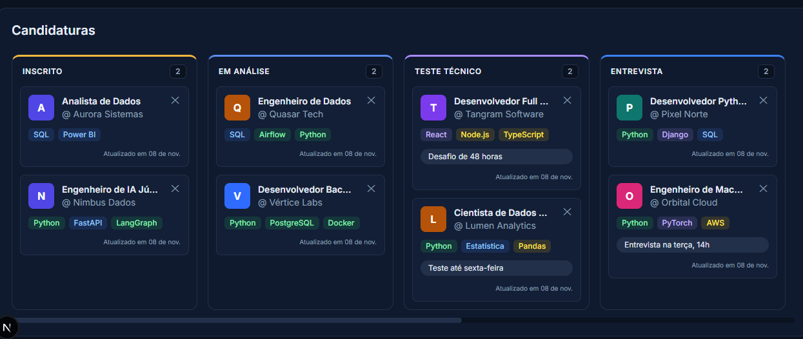
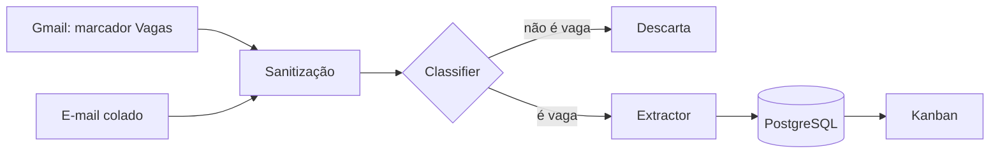
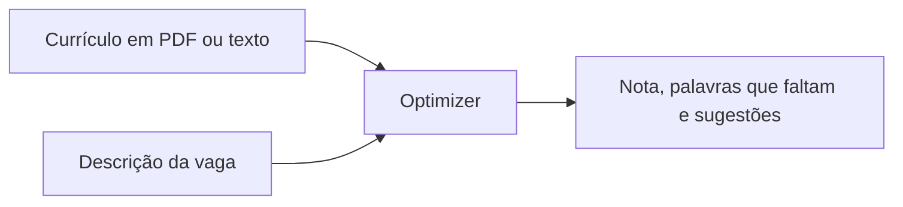

<p align="center">
  <picture>
    <source media="(prefers-color-scheme: dark)" srcset="frontend/public/logo-dark.png">
    
  </picture>
</p>

# ResuMe

O nome é um trocadilho entre _resume_ (currículo) e _me_ (eu). A ideia é ter um assistente pessoal para cuidar das minhas candidaturas.

Comecei esse projeto porque, quando você se candidata a muitas vagas ao mesmo tempo, perde o controle rápido: em qual etapa cada processo está, quem já respondeu, quem recusou. E ainda tem o trabalho de adaptar o currículo para cada vaga. O ResuMe tenta resolver as duas coisas com agentes de IA.

Também é meu projeto de portfólio na trilha de AI Engineer, então está em desenvolvimento e o código é aberto.






# O que já funciona

**Acompanhar candidaturas**

- Um kanban com uma coluna por etapa (inscrição, análise, teste técnico, entrevista, oferta e rejeição). Dá para arrastar um cartão para outra coluna, e o status é salvo no banco.
- Os e-mails entram de três jeitos: você cola o texto de um e-mail, clica em **Sincronizar Gmail**, ou deixa a sincronização automática rodar duas vezes por dia. Em todos os casos o ResuMe lê só os e-mails com o marcador `Vagas`.
- Cada e-mail passa por um fluxo de agentes: o Classifier decide se é de processo seletivo (newsletter e spam são descartados) e o Extractor tira empresa, cargo, status, requisitos e próximos passos.
- Se já existe uma candidatura da mesma empresa e cargo, o ResuMe atualiza o status em vez de criar outro cartão.
- Um e-mail do Gmail nunca é analisado duas vezes: o ResuMe guarda só o código dele e o resultado, sem o conteúdo.
- Cartões em que a IA ficou em dúvida ganham um aviso para você conferir.

**Adaptar o currículo**

- Você envia o seu currículo em PDF (ou cola o texto) e a descrição de uma vaga. O Resume Optimizer devolve uma nota de compatibilidade, as palavras da vaga que faltam no currículo e sugestões de frases.
- Ele foi instruído a nunca inventar experiência: se a vaga pede uma tecnologia que você não usou, ela aparece como "faltando" e não vira uma frase fingindo que você sabe.
- A nota é uma estimativa do modelo, não uma medida exata. Use como guia e revise cada sugestão.
- A análise é para fazer **antes** de se inscrever. Por isso não existe um botão de analisar nos cartões do quadro: quem já está inscrito já mandou o currículo.

**Interface**

- Tema claro e escuro, menu de perfil, busca e um painel para cada função.

## Como funciona





O fluxo dos e-mails é um grafo do LangGraph, e cada etapa é um nó separado. Isso facilita testar e trocar cada parte.

## Tecnologias

- Back-end: Python, FastAPI, Pydantic e SQLAlchemy
- Agentes: LangGraph
- Banco de dados: PostgreSQL
- Leitura dos e-mails (Classifier e Extractor): Gemini, ou Ollama para rodar um modelo local
- Resume Optimizer: Grok, da xAI
- Gmail: API do Gmail com acesso somente leitura
- Front-end: Next.js, React e Tailwind CSS
- Testes: Pytest
- Ambiente: Docker Compose

## Como rodar

Você vai precisar de Docker e das chaves de API dos provedores (veja a seção sobre modelos). Os comandos abaixo são do PowerShell. No Linux ou macOS, use `cp` no lugar de `Copy-Item`.

```powershell
git clone https://github.com/RianLMA-dev/ResuMe.git
cd ResuMe

Copy-Item .env.example .env
# abra o .env e cole as suas chaves de API

docker compose up --build
```

Abra http://localhost:3000. A documentação da API fica em http://localhost:8000/docs.

Isso sobe três serviços: o banco (PostgreSQL), a API e o site. A API só inicia depois que o banco está pronto. O arquivo `.env` precisa ter só linhas no formato `CHAVE=valor`, sem aspas.

O Gmail é opcional. Sem ele, dá para colar e-mails e usar todo o resto. Para ligá-lo, veja "Conectando o Gmail".

### Para desenvolver

As imagens não recarregam sozinhas quando o código muda. Para desenvolver, suba só o banco e rode a API e o site no seu computador, com recarga automática:

```powershell
docker compose up -d db

cd backend
python -m venv .venv
.venv\Scripts\Activate.ps1
pip install -r requirements.txt
uvicorn app.main:app --reload
```

Em outro terminal:

```powershell
cd frontend
npm install
npm run dev
```

Antes disso, pare os contêineres da API e do site (`docker compose stop backend frontend`), para as portas 8000 e 3000 ficarem livres. O front-end procura a API em `http://localhost:8000`. Para mudar, crie `frontend/.env.local` com `NEXT_PUBLIC_API_URL=...`.

## Estrutura do projeto

```
ResuMe/
├── backend/            API em FastAPI, agentes em LangGraph e testes
│   ├── app/
│   │   ├── agents/     Classifier, Extractor e Optimizer
│   │   ├── api/        rotas
│   │   ├── models/     tabelas
│   │   ├── schemas/    formatos de entrada e saída
│   │   └── services/   Gmail, sanitização e sincronização
│   ├── tests/
│   └── sync_job.py     sincronização agendada
├── frontend/           site em Next.js
└── docker-compose.yml
```

## Qual modelo usar

Cada pessoa usa as próprias chaves (_bring your own key_), e o código nunca depende de uma chave minha. O `.env.example` lista todas as variáveis.

- **E-mails (Classifier e Extractor):** Gemini por padrão, com `GOOGLE_API_KEY`. Existe camada gratuita, mas os limites mudam, então confira no [Google AI Studio](https://aistudio.google.com/apikey). Com `LLM_PROVIDER=ollama`, dá para rodar um modelo local.
- **Resume Optimizer:** Groq, com `GROQ_API_KEY`. Veja os preços e limites no site [Groq](https://console.groq.com/keys).

No plano gratuito do Gemini, o limite de requisições por minuto vale por modelo. Se estourar, defina `GEMINI_CLASSIFIER_MODEL` e `GEMINI_EXTRACTOR_MODEL` com modelos diferentes, e cada etapa passa a gastar o limite de um modelo próprio. Os modelos mudam de nome e saem de catálogo com o tempo: se der erro de modelo não encontrado, atualize o nome no `.env`.

## Conectando o Gmail

O ResuMe só lê os e-mails que você marcar com o rótulo `Vagas`. Ele pede permissão **somente de leitura**: não consegue enviar, apagar nem alterar nada na sua caixa de entrada. Para configurar:

1. No [Google Cloud](https://console.cloud.google.com), crie um projeto e ative a **Gmail API**.
2. Em **Google Auth Platform**, configure a tela de consentimento como **Externo** e adicione o seu Gmail em **Usuários de teste**.
3. Crie um cliente OAuth do tipo **App para computador** e baixe o JSON.
4. Salve o arquivo como `backend/secrets/credentials.json`. Essa pasta é ignorada pelo Git, não entra nas imagens do Docker e é montada no contêiner da API. Nada dela pode ir para o repositório.
5. No Gmail, crie o marcador `Vagas` e um filtro que o aplique nos e-mails de processo seletivo. Quanto mais certeiro o filtro, menos e-mails irrelevantes passam pela IA.
6. No seu computador (não dentro do Docker, porque abre o navegador), rode:

```powershell
cd backend
python -m venv .venv
.venv\Scripts\Activate.ps1
pip install -r requirements.txt
python try_gmail.py
```

Autorize no navegador. Isso gera o `token.json` em `backend/secrets`, que a API usa. Enquanto o app do Google Cloud estiver em modo de teste, a autorização expira a cada 7 dias: quando isso acontecer, o botão de sincronizar avisa, e é só rodar o `try_gmail.py` de novo.

## Sincronização automática

O script `backend/sync_job.py` lê os e-mails novos do marcador `Vagas` em lotes, com pausa de 1 minuto entre eles para respeitar o limite por minuto da IA, e analisa no máximo 20 e-mails por execução. Se a IA falhar, espera e tenta de novo, e se continuar falhando, para. O registro fica em `backend/logs/sync.log` e guarda só contagens e erros, nunca o conteúdo dos e-mails.

Ele usa o Python do ambiente virtual do back-end e conversa com o banco em `localhost:5432`, que o Docker Compose já deixa aberto. No Windows, dá para agendar duas execuções por dia:

```powershell
$backend = "C:\caminho\para\ResuMe\backend"
$action = New-ScheduledTaskAction -Execute "$backend\.venv\Scripts\python.exe" -Argument "sync_job.py" -WorkingDirectory $backend
$triggers = @(
    New-ScheduledTaskTrigger -Daily -At 9:00AM
    New-ScheduledTaskTrigger -Daily -At 6:00PM
)
$settings = New-ScheduledTaskSettingsSet -StartWhenAvailable -AllowStartIfOnBatteries -DontStopIfGoingOnBatteries -ExecutionTimeLimit (New-TimeSpan -Hours 1)
Register-ScheduledTask -TaskName "ResuMe Gmail Sync" -Action $action -Trigger $triggers -Settings $settings
```

Para ver como foi a última execução:

```powershell
Get-ScheduledTaskInfo -TaskName "ResuMe Gmail Sync" | Select-Object LastRunTime, LastTaskResult
```

O resultado `0` é sucesso, `2` é autorização do Gmail expirada e `1` é outro erro (o `sync.log` diz qual). No Linux ou macOS, o equivalente é uma linha no `cron`:

```
0 9,18 * * * cd /caminho/para/ResuMe/backend && .venv/bin/python sync_job.py
```

## Seus dados e privacidade

E-mails de recrutadores e currículos têm dados pessoais, então tentei me preocupar com isso desde o começo.

- Antes de qualquer chamada a um modelo, o texto dos e-mails passa por uma sanitização que troca e-mails, telefones, CPFs e links por marcadores como `[EMAIL]`.
- Ela é feita com expressões regulares, então **não pega nomes de pessoas**. Se isso for um problema, use o Ollama para os e-mails.
- O texto dos e-mails vai para o Gemini, e o currículo e a descrição da vaga vão para o Grok. Tire do currículo o que você não quer compartilhar, como endereço e telefone, e leia a política de dados de cada provedor: em planos gratuitos, alguns usam o conteúdo para melhorar os modelos.
- No Gmail, o ResuMe só lê o que tem o marcador `Vagas`.
- O ResuMe foi feito para rodar na sua máquina. **A API não tem login**, então não exponha as portas 3000, 8000 e 5432 na internet.

Os dados ficam num volume do Docker (`pgdata`). Para fazer uma cópia de segurança:

```powershell
docker exec resume-db pg_dump -U resume -d resume --clean --if-exists | Out-File -Encoding utf8 resume_backup.sql
```

Guarde o arquivo fora do repositório, porque ele tem os seus dados. Para restaurar:

```powershell
Get-Content resume_backup.sql | docker exec -i resume-db psql -U resume -d resume
```

Nunca rode `docker compose down -v` nem `docker system prune --volumes`: os dois apagam o banco.

## Problemas comuns

- **`failed to read .env ... unexpected character`:** o `.env` só aceita linhas `CHAVE=valor`, sem aspas. Uma linha solta, como um caminho de pasta, faz o Docker recusar o arquivo. O número da linha vem na mensagem.
- **Porta já em uso:** pare o `uvicorn` e o `npm run dev` do seu computador antes de subir os contêineres.
- **`read-only file system` ou erro de espaço no Docker:** o disco encheu. Libere espaço no Windows, rode `wsl --shutdown` e abra o Docker Desktop de novo. As imagens de construção ocupam vários gigabytes, e `docker builder prune` limpa o que sobrou sem apagar o banco.
- **"A autorização do Gmail expirou":** rode `python try_gmail.py` de novo no seu computador.
- **"A IA parou" ao sincronizar:** quase sempre é o limite por minuto do Gemini. Espere um minuto, ou use modelos diferentes para o Classifier e o Extractor.

## Testes

```powershell
cd backend
pytest -v
```

Os testes usam modelos e Gmail simulados e um SQLite em memória, então rodam sem chaves de API e sem gastar nada.

## O que falta fazer

- [x] Schemas e saída estruturada
- [x] Sanitização de dados pessoais
- [x] Classifier e Extractor no LangGraph
- [x] API com testes automatizados
- [x] Persistência no PostgreSQL
- [x] Kanban em Next.js, com tema claro e escuro
- [x] Leitura do Gmail pelo marcador `Vagas`
- [x] Sincronização automática, com pausas para respeitar os limites
- [x] Resume Optimizer com currículo em PDF
- [x] Projeto completo rodando com um comando (Docker Compose)
- [ ] Integração contínua com GitHub Actions
- [ ] Etapa de "interesse" no kanban, para analisar a vaga antes de se inscrever
- [ ] Aba de sugestões de vagas, lendo os alertas do LinkedIn e do Indeed
- [ ] Logo da empresa nos cartões
- [ ] Um jeito melhor de ligar e-mails diferentes ao mesmo processo (hoje a comparação é por texto)
- [ ] Migrações com Alembic
- [ ] Demonstração pública com dados de exemplo

## Licença

MIT.
