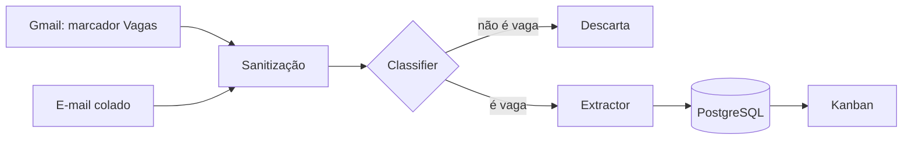
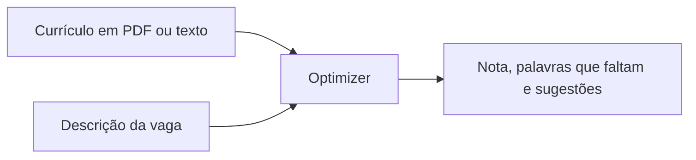

<p align="center">
  <picture>
    <source media="(prefers-color-scheme: dark)" srcset="frontend/public/logo-dark.png">
    
  </picture>
</p>

# ResuMe

O nome é um trocadilho entre *resume* (currículo) e *me* (eu). A ideia é ter um assistente pessoal para cuidar das minhas candidaturas.

Comecei esse projeto porque, quando você se candidata a muitas vagas ao mesmo tempo, perde o controle rápido: em qual etapa cada processo está, quem já respondeu, quem recusou. E ainda tem o trabalho de adaptar o currículo para cada vaga. O ResuMe tenta resolver as duas coisas com agentes de IA.

Também é meu projeto de portfólio na trilha de AI Engineer, então está sendo construído aos poucos e o código é aberto.

## O que já funciona

**Acompanhar candidaturas**

- Um kanban com uma coluna por etapa (inscrição, análise, teste técnico, entrevista, oferta e rejeição). Dá para arrastar um cartão para outra coluna, e o status é salvo no banco.
- Os e-mails entram de dois jeitos: você cola o texto de um e-mail, ou clica em **Sincronizar Gmail**, que lê só os e-mails com o marcador `Vagas`.
- Cada e-mail passa por um fluxo de agentes: o Classifier decide se é de processo seletivo (newsletter e spam são descartados) e o Extractor tira empresa, cargo, status, requisitos e próximos passos.
- Se já existe uma candidatura da mesma empresa e cargo, o ResuMe atualiza o status em vez de criar outro cartão.
- Um e-mail do Gmail nunca é analisado duas vezes: o ResuMe guarda só o código dele e o resultado, sem o conteúdo.
- Cartões em que a IA ficou em dúvida ganham um aviso para você conferir.

**Adaptar o currículo**

- Você envia o seu currículo em PDF (ou cola o texto) e a descrição de uma vaga. O Resume Optimizer devolve uma nota de compatibilidade, as palavras da vaga que faltam no currículo e sugestões de frases.
- Ele foi instruído a nunca inventar experiência: se a vaga pede uma tecnologia que você não usou, ela aparece como "faltando" e não vira uma frase fingindo que você sabe.
- A nota é uma estimativa do modelo, não uma medida exata. Use como guia e revise cada sugestão.

**Interface**

- Tema claro e escuro, menu de perfil, busca e um painel para cada função.

## Como funciona





O fluxo dos e-mails é um grafo do LangGraph, e cada etapa é um nó separado. Isso facilita testar e trocar cada parte.

## Tecnologias

- Back-end: Python, FastAPI, Pydantic e SQLAlchemy
- Agentes: LangGraph
- Banco de dados: PostgreSQL (em Docker, para rodar local)
- Leitura dos e-mails: Gemini (padrão) ou Ollama, no lugar do Gemini, para rodar tudo localmente
- Resume Optimizer: Grok, da xAI
- Gmail: API do Gmail com acesso somente leitura
- Front-end: Next.js, React e Tailwind CSS
- Testes: Pytest

## Como rodar

Você vai precisar de Python 3.11 ou mais novo, Node.js, Docker e as chaves de API dos provedores (veja a seção sobre modelos). Os comandos abaixo são do PowerShell. No Linux ou macOS, use `cp` no lugar de `Copy-Item` e `source .venv/bin/activate` para ativar o ambiente.

```powershell
git clone https://github.com/RianLMA-dev/ResuMe.git
cd ResuMe

Copy-Item .env.example .env
# abra o .env e cole as suas chaves de API

docker compose up -d

cd backend
python -m venv .venv
.venv\Scripts\Activate.ps1
pip install -r requirements.txt
uvicorn app.main:app --reload
```

Em outro terminal, o front-end:

```powershell
cd frontend
npm install
npm run dev
```

Abra http://localhost:3000. A documentação da API fica em http://127.0.0.1:8000/docs.

O front-end procura a API em `http://localhost:8000`. Para mudar, crie `frontend/.env.local` com `NEXT_PUBLIC_API_URL=...`.

## Conectando o Gmail

O ResuMe só lê os e-mails que você marcar com o rótulo `Vagas`. Ele pede permissão **somente de leitura**: não consegue enviar, apagar nem alterar nada na sua caixa de entrada. Para configurar:

1. No [Google Cloud](https://console.cloud.google.com), crie um projeto e ative a **Gmail API**.
2. Em **Google Auth Platform**, configure a tela de consentimento como **Externo** e adicione o seu Gmail em **Usuários de teste**.
3. Crie um cliente OAuth do tipo **App para computador** e baixe o JSON.
4. Salve o arquivo como `backend/secrets/credentials.json`. Essa pasta é ignorada pelo Git, e nada dela pode ir para o repositório.
5. No Gmail, crie o marcador `Vagas` e um filtro que o aplique nos e-mails de processo seletivo. Quanto mais certeiro o filtro, menos e-mails irrelevantes passam pela IA.
6. Rode `python try_gmail.py` dentro de `backend` e autorize no navegador. Isso gera o `token.json`, também fora do Git.

Enquanto o app do Google Cloud estiver em modo de teste, a autorização expira a cada 7 dias. Quando isso acontecer, o botão de sincronizar avisa, e é só rodar o `try_gmail.py` de novo.

## Qual modelo usar

Cada pessoa usa as próprias chaves (*bring your own key*), e o código nunca depende de uma chave minha.

- **E-mails (Classifier e Extractor):** Gemini por padrão, com `GOOGLE_API_KEY` no `.env`. Existe camada gratuita, mas os limites mudam, então confira no [Google AI Studio](https://aistudio.google.com/apikey). Com `LLM_PROVIDER=ollama`, dá para rodar um modelo local.
- **Resume Optimizer:** Grok, com `XAI_API_KEY` no `.env`. Veja os preços e limites no site da xAI.

Os modelos mudam de nome e saem de catálogo com o tempo. Se der erro de modelo não encontrado, atualize o nome no `.env`.

## Sobre privacidade

E-mails de recrutadores e currículos têm dados pessoais, então tentei me preocupar com isso desde o começo.

- Antes de qualquer chamada a um modelo, o texto passa por uma sanitização que troca e-mails, telefones, CPFs e links por marcadores como `[EMAIL]`.
- Ela é feita com expressões regulares, então **não pega nomes de pessoas**. Se isso for um problema, tire o seu nome do currículo antes de enviar, ou use o Ollama para os e-mails.
- O texto dos e-mails vai para o Gemini, e o currículo e a descrição da vaga vão para o Grok. Leia a política de dados de cada provedor: em planos gratuitos, alguns usam o conteúdo para melhorar os modelos.
- No Gmail, o ResuMe só lê o que tem o marcador `Vagas`.

## Testes

```powershell
cd backend
pytest -v
```

Os testes usam modelos e Gmail simulados e um SQLite em memória, então rodam sem chaves de API e sem gastar nada.

## O que falta fazer

- [x] Schemas e saída estruturada
- [x] Sanitização de dados pessoais
- [x] Classifier e Extractor no LangGraph
- [x] API com testes automatizados
- [x] Persistência no PostgreSQL
- [x] Kanban em Next.js, com tema claro e escuro
- [x] Leitura automática do Gmail pelo marcador `Vagas`
- [x] Resume Optimizer com currículo em PDF
- [ ] Sincronização automática do Gmail
- [ ] Aba de sugestões de vagas, lendo os alertas do LinkedIn e do Indeed
- [ ] Um jeito melhor de ligar e-mails diferentes ao mesmo processo (hoje a comparação é por texto)
- [ ] Migrações com Alembic
- [ ] Dataset de avaliação para comparar modelos em acurácia e custo
- [ ] CI com GitHub Actions e deploy

## Licença

MIT.
